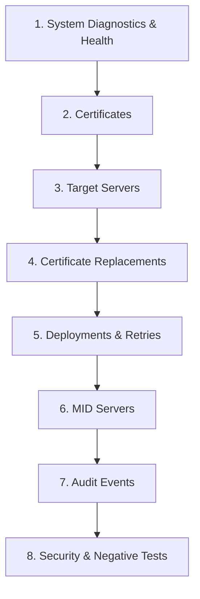

# Postman Collection for Certificate Deployment Manager (CDM)

This directory contains the automated Postman test collection, environment configuration, and OpenAPI 3.0 specification for the **Certificate Deployment Manager (CDM)** enterprise platform.

---

## Files Included

1. **[`CDM_API_Collection.postman_collection.json`](file:///Users/ayushyadav/CDm-repo_gressroots/postman/CDM_API_Collection.postman_collection.json)**
   - Schema: Postman Collection v2.1.0
   - Automated JavaScript test assertions on every request (HTTP status codes, response times, data types, and RFC 7807 problem details).
   - Dynamic environment variable chaining (`certificateId`, `serverId`, `replacementId`, `deploymentJobId`, `midServerId`).
   - Configured with Basic Authentication inheritance from parent collection.

2. **[`CDM_Local.postman_environment.json`](file:///Users/ayushyadav/CDm-repo_gressroots/postman/CDM_Local.postman_environment.json)**
   - Environment definitions for local development (`baseUrl`, `adminUsername`, `adminPassword`, and dynamic entity ID placeholders).

3. **[`cdm-openapi.json`](file:///Users/ayushyadav/CDm-repo_gressroots/postman/cdm-openapi.json)**
   - OpenAPI 3.0 specification JSON export for offline schema validation and code generation.

---

## Endpoint Catalog & Collection Structure

The collection is organized into **8 categorized folders** representing the full operational lifecycle:



### 1. System Diagnostics & Health
- `GET /api/v1/system/status`: Real-time system diagnostics, PostgreSQL database connectivity, and version.
- `GET /api/v1/system/ping`: Lightweight container liveness probe returning `"pong"`.
- `GET /actuator/health`: Spring Boot Actuator readiness and composite component health probe.
- `GET /actuator/info`: Application runtime build and git metadata.
- `GET /actuator/metrics`: Micrometer metrics registry index.
- `GET /actuator/prometheus`: Prometheus scrape endpoint in standard exposition format.
- `GET /v3/api-docs`: OpenAPI 3.0 JSON specification.

### 2. Certificates
- `GET /api/v1/certificates`: Paginated query with sorting (`sortBy`, `direction`) and multi-field filters (`status`, `source`, `commonName`, `issuer`). Automatically captures first `certificateId` into environment.
- `GET /api/v1/certificates/{id}`: Single certificate detail inspection. Verifies private keys and secrets are never exposed.

### 3. Target Servers
- `GET /api/v1/servers`: Paginated query with technology (`IIS`, `APACHE`, `NGINX`, `TOMCAT`, `JAVA_KEYSTORE`, `F5_BIGIP`), `environment`, and `status` filters. Captures `serverId`.
- `GET /api/v1/servers/{id}`: Target server configuration inspection. Verifies CyberArk credentials and passwords are never exposed.

### 4. Certificate Replacements
- `GET /api/v1/replacements`: Paginated query with `matchStatus` (`AUTO_MATCHED`, `MANUAL_MATCHED`, `UNMATCHED`, etc.) and certificate filters. Captures `replacementId`.
- `GET /api/v1/replacements/{id}`: Deep inspection of match scoring and correlation breakdown.

### 5. Deployments & Retries
- `GET /api/v1/deployments`: Paginated query with `status`, `targetHost`, and `deploymentType` filters. Captures `deploymentJobId`.
- `GET /api/v1/deployments/{id}`: Complete deployment job state machine history and execution logs.
- `POST /api/v1/deployments/{id}/retry`: Triggers manual retry workflow for failed/stalled jobs with `X-Correlation-ID` header.
- `POST /api/v1/deployments/{id}/verify`: Triggers live TLS endpoint handshake verification against target host.

### 6. MID Servers
- `GET /api/v1/mid-servers`: Paginated list of registered ServiceNow MID Server execution agent nodes. Captures `midServerId`.
- `GET /api/v1/mid-servers/{id}/health`: Live diagnostic health probe for MID agent node.

### 7. Audit Events
- `GET /api/v1/audit-events`: Immutable audit trail with filtering by `correlationId`, `eventType`, `action`, `actor`, `entityName`, `entityId`, `outcome`, and ISO-8601 timestamp range (`from`, `to`).

### 8. Security & Negative Tests
- `GET /api/v1/certificates` (No Auth): Asserts `401 Unauthorized` with RFC 7807 problem details.
- `GET /api/v1/certificates/00000000-0000-0000-0000-000000000000`: Asserts `404 Not Found` for non-existent UUIDs.
- `GET /api/v1/certificates?size=500`: Asserts `400 Bad Request` when page size exceeds `@Max(100)` constraint.

---

## How to Import & Run in Postman

1. Open Postman.
2. Click **Import** (top left).
3. Select both `CDM_API_Collection.postman_collection.json` and `CDM_Local.postman_environment.json`.
4. Set the active environment to **CDM Local Environment** in the top-right environment selector.
5. Ensure the CDM application is running on port `8085` (`SPRING_PROFILES_ACTIVE=local ./mvnw spring-boot:run`).
6. Open **Collection Runner** and click **Run Certificate Deployment Manager (CDM)** to execute all 20+ automated tests sequentially.

---

## Running with Newman (CLI / CI/CD)

Execute the full suite headlessly in CI/CD pipelines using Newman:

```bash
# Install Newman and HTML reporter
npm install -g newman newman-reporter-htmlextra

# Run test collection with environment
newman run postman/CDM_API_Collection.postman_collection.json \
  -e postman/CDM_Local.postman_environment.json \
  --reporters cli,htmlextra \
  --reporter-htmlextra-export postman/test-report.html
```
